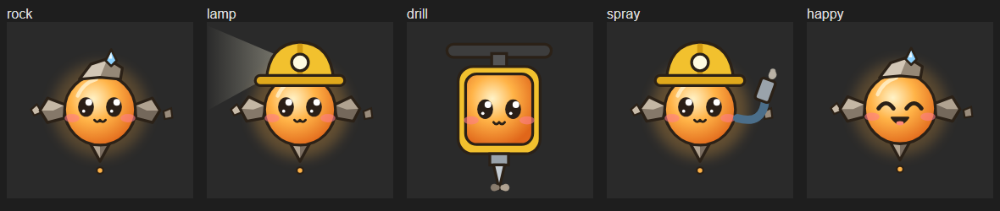
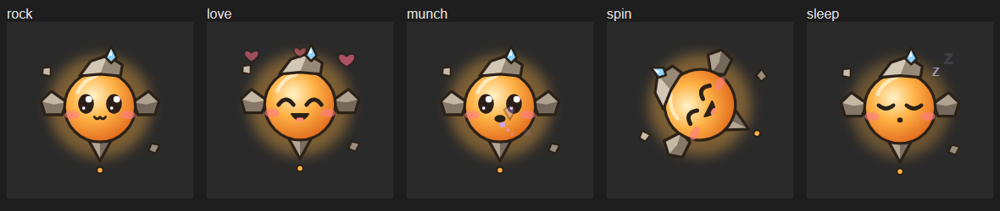

# Scree

A small rock spirit that lives in Claude Code. Scree sits in a pane beside the chat (and, on Windows, on your desktop), changes form while Claude works, keeps your notes, shows your 5-hour usage as a ring, and is a pet you can feed and play with.




## What it does

- **Animated companion pane.** Scree maps the face with a cap lamp while Claude reads, takes over a rock drill while it runs commands, and sprays shotcrete while it edits files.
- **Session updates.** What Claude is working on, when it needs your approval, and when it is your turn.
- **5-hour usage.** A ring around the desktop pet fills as your 5-hour limit is used (amber from 70%, red from 90%). The pane shows it as text.
- **Notes.** Say "Scree, note that ..." or type `/note <text>`. Ask "what did I note about X?" to search. Notes are plain Markdown files, one per month.
- **Pet.** Pet, feed, play and tuck in Scree. Food, joy and energy drift over real time and carry between sessions.
- **Persona.** Claude answers in chat as Scree: brief, warm, the odd rock pun. Documents and code stay plain.

## Install the mod

At the prompt of a Claude Code terminal session:

```
/plugin install scree --marketplace Shuvamadh/scree
```

From a shell:

```
claude plugin install scree --marketplace Shuvamadh/scree
```

In the desktop app, where `/plugin` does not run: click + next to the prompt box, then Plugins, Add marketplace with `Shuvamadh/scree`, then Add plugin.

Answer `y` to add the marketplace and pick the user scope. You can set your name (what Scree calls you) and a notes folder; leave the folder empty to use `<home>/Scree`. Type `/scree` to bring the pane back if you close it.

## Desktop pet (Windows, optional)

A transparent, always-on-top Scree with a 5-hour usage ring, a chat button and a voice button (Windows voice typing). It needs Python 3 and the mod above.

1. Download this repository (Code, Download ZIP) and unzip it somewhere you keep.
2. In PowerShell, run `desktop\install_windows.ps1` from that folder. It installs PySide6, starts Scree and adds it to Windows startup.

Drag Scree anywhere, double-click to pet it, right-click for feed, play, sleep, hide and quit. If you set a custom notes folder in the mod, set the same folder in the `SCREE_DIR` environment variable for the desktop pet.

## License

MIT
